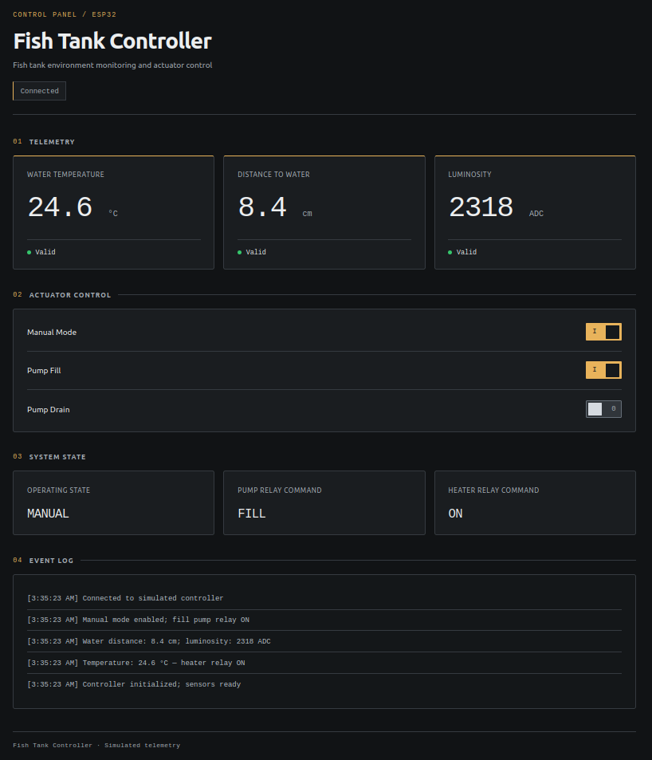
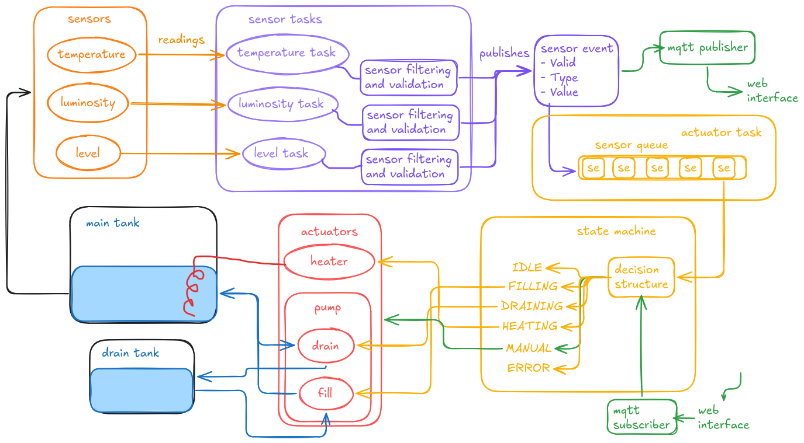

# IoT Fish Tank Control and Monitoring

An ESP32-WROOM-32 controller for monitoring a fish tank, regulating its water level and temperature, and operating its pumps through a local web dashboard.

The system uses a main fish tank, a clean water supply tank, and a drain tank. The fill pump adds water, the drain pump removes it, and the heater regulates temperature. The firmware is built with ESP-IDF and FreeRTOS, with separate modules for sensing, control, actuators, and communication.

## Features

- Temperature, water level distance, and raw luminosity monitoring.
- Automatic water level regulation through fill and drain pumps.
- Automatic heating with a low-water cutoff.
- Local Wi-Fi dashboard for monitoring and manual pump commands.
- Critical sensor checks, actuator interlocks, and operation timeouts.
- Firmware logs, dashboard event feedback, and Unity state-machine tests.

Luminosity is currently monitored as raw ADC data; it does not trigger water replacement.

## Dashboard

The dashboard shows sensor readings and validity, the operating state, relay commands, and an event log. A manual-mode switch enables commands for the fill and drain pumps. The heater stays off in MANUAL, while sensor checks and operation timeouts remain active.



*Dashboard preview with simulated values. The firmware keeps the heater off in MANUAL.*

## Usage

With PlatformIO installed and the ESP32 connected by USB, run from the project root. Replace `/dev/ttyACM0` if the board uses another port:

```sh
pio run -e esp32dev -t upload --upload-port /dev/ttyACM0
```

Connect to Wi-Fi **TankController** with password **TankControl32**, keep the connection even without Internet, and open **http://192.168.4.1/**. The access point accepts one device. Credentials and channel are configured in `src/main.c`.

Enable **Manual Mode** before sending pump commands; valid temperature and level readings and no blocking fault are required. Disable it to stop manual outputs and resume automatic control. Dashboard disconnection handling is still pending: disconnecting does not currently stop a manual pump, though level checks and timeouts remain active.

To read firmware logs:

```sh
pio device monitor --port /dev/ttyACM0 --baud 115200
```

## Firmware

`app_main()` initializes the sensor and actuator drivers, creates the sensor queue through the control module, starts the control and sensor tasks, and calls `init_communication()` to start Wi-Fi and the HTTP server. Communication startup failures are logged without stopping automatic control.

Each sensor has its own FreeRTOS task. It periodically reads the sensor, creates a `sensor_event_t`, marks whether the reading is valid, and publishes it to the sensor queue. The `type` field identifies the sensor, and the `value` union stores its reading.

The control task consumes sensor events and a separate manual-command queue. The state machine stores the latest readings, checks critical inputs, evaluates the operating state, and applies actuator outputs through the pump and heater drivers.

Sensor and communication modules do not control GPIOs directly. The control task owns the state machine, which decides when each actuator should be enabled.



*Control-system overview. MQTT and sensor filtering shown in the diagram are still pending; the current dashboard communicates through HTTP.*

### Project Structure

```text
src/
├── main.c
├── core/           # Sensor tasks, control task, events, and state machine
├── sensors/        # Temperature, level, and luminosity drivers
├── actuators/      # Pump and heater drivers
└── communication/  # Wi-Fi, HTTP server, dashboard, and manual commands
test/
└── test_state_machine/
```

The application uses ESP-IDF drivers, FreeRTOS queues and tasks, `esp_http_server`, and cJSON for command parsing.

### Sensors and Actuators

| Device | Driver | Behavior |
| --- | --- | --- |
| DS18B20 temperature sensor | `src/sensors/temperature` | Reports temperature in Celsius, with 1-Wire bus and scratchpad CRC checks. |
| HC-SR04 ultrasonic level sensor | `src/sensors/level` | Reports distance to the water surface in centimeters; a larger distance means less water. |
| LDR luminosity sensor | `src/sensors/luminosity` | Reports the raw ADC value. |
| Fill pump | `src/actuators/pumps` | Adds water during automatic filling or manual commands. |
| Drain pump | `src/actuators/pumps` | Removes water during automatic draining or manual commands. |
| Heater | `src/actuators/heater` | Heats during automatic operation; stays off in MANUAL. |

Relay outputs are initialized off. Drivers apply the state machine's requests; dashboard relay indicators reflect successful driver commands, without physical actuator feedback.

### Operating States

| State | Activation condition | Actuator behavior |
| --- | --- | --- |
| `SYSTEM_STATE_IDLE` | Initial state, completed operation, recovered error, or readings within automatic limits. | All outputs off. |
| `SYSTEM_STATE_FILLING` | Water-surface distance above 25 cm. | Fill pump on until distance reaches 14 cm or less. |
| `SYSTEM_STATE_DRAINING` | Water-surface distance below 8 cm. | Drain pump on until distance reaches 14 cm or more. |
| `SYSTEM_STATE_HEATING` | Temperature below 24 °C and level conditions permit heating. | Heater on until 26 °C; stops if distance exceeds 25 cm. |
| `SYSTEM_STATE_MANUAL` | Accepted dashboard mode command with valid critical readings and no blocking fault. | Selected pump follows commands; the other pump and heater stay off. |
| `SYSTEM_STATE_ERROR` | Invalid critical sensor data, actuator failure, or operation timeout. | Requests shutdown of all outputs and retries failed shutdowns. |

From IDLE, water level regulation takes priority over starting heating. Manual filling stops at a distance of 8 cm or less, and manual draining stops at 25 cm or more. Pump operations are limited to 5 minutes and heating to 60 minutes; operation timeouts remain latched until firmware restart.

### FreeRTOS Tasks

| Task | Source | Core | Priority | Stack size | Delay / trigger |
| --- | --- | --- | --- | --- | --- |
| `control_task` | `src/core/control_task.c` | 1 | 3 | 3072 bytes | Sensor queue wait up to 100 ms; commands and timeout checks |
| `temperature_task` | `src/core/sensor_tasks.c` | 1 | 2 | 3072 bytes | 2000 ms after acquisition |
| `level_task` | `src/core/sensor_tasks.c` | 1 | 2 | 3072 bytes | 1000 ms after acquisition |
| `luminosity_task` | `src/core/sensor_tasks.c` | 1 | 2 | 3072 bytes | 2000 ms after acquisition |
| HTTP server task | `src/communication/web_server/web_server.c` | 0 | 5 | 6144 bytes | HTTP requests |

### Web Server

The server delivers the embedded HTML, CSS, and JavaScript through `GET /`. The browser polls `GET /xml` every 2 seconds, reading a mutex-protected snapshot of control status. `POST /controlMode` and `POST /controlPump` requests pass through `manual_control` to the control task's command queue. Queue acceptance does not confirm execution; the dashboard checks the command result in later telemetry.

### ESP32 Pins

| Function | ESP32 pin/configuration |
| --- | --- |
| Temperature data | `GPIO_NUM_32` |
| Level trigger | `GPIO_NUM_5` |
| Level echo | `GPIO_NUM_18` |
| Luminosity ADC unit | `ADC_UNIT_1` |
| Luminosity ADC channel | `ADC_CHANNEL_6` |
| Fill pump relay | `GPIO_NUM_26` |
| Drain pump relay | `GPIO_NUM_27` |
| Heater relay | `GPIO_NUM_25` |
| Relay active level | `true` / active high |
| Level sensor timeout | `30000 us` |

### Unity Tests

The suite tests the production state machine using simulated actuators, without accessing relay GPIOs. It covers automatic transitions, manual commands, level limits, output interlocks, actuator failures, and operation timeouts.

Connect the ESP32 by USB, close the serial monitor, and run:

```sh
pio test -e esp32dev_test --upload-port /dev/ttyACM0 --test-port /dev/ttyACM0
```

After testing, restore the production firmware:

```sh
pio run -e esp32dev -t upload --upload-port /dev/ttyACM0
```

## Next Steps

- Dashboard disconnection handling.
- Sensor filtering and validation.
- NVS persistence.
- Watchdog and health monitoring.
- MQTT communication.
- OTA update support.
